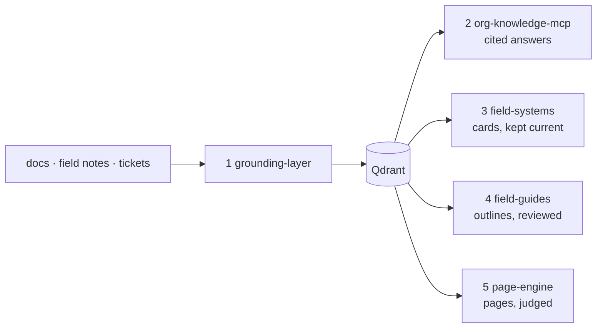

# field-kit

**Go-to-market systems you can run: five kits, one made-up company, a measured result in every README.**

Most teams have the same sources: product docs, what customers said on calls, a support queue. This
is the path from those sources to the assets a field team uses, built so that every sentence in an
asset traces to a row in Qdrant and a person approves what changes.

Start here. Each kit is its own repo, and they run in this order.

| # | Kit | You get | Measured on the fixtures |
|---|---|---|---|
| 1 | [grounding-layer](https://github.com/meinsta/grounding-layer) | A scheduled refresh that keeps docs, field notes and tickets current in Qdrant, ending in a recall gate | 9 of 10 golden questions find their answer in the top 3 |
| 2 | [org-knowledge-mcp](https://github.com/meinsta/org-knowledge-mcp) | An MCP server that answers from those sources and checks every claim is cited | 10 of 10 sourced claims accepted, 20 of 20 made-up ones rejected |
| 3 | [field-systems](https://github.com/meinsta/field-systems) | Field cards, a weekly keep-current check and a review queue | A changed docs sentence was detected, proposed, and applied only after approval |
| 4 | [field-guides](https://github.com/meinsta/field-guides) | A guide outline that keeps what ships today apart from what is open, with expert review | One expert comment moved one sentence to the open list |
| 5 | [page-engine](https://github.com/meinsta/page-engine) | Product pages and paid landings where authored words are judged in code | The shipped page is READY; three bad leads were each flagged |

## Run all five

You need `python3`, `git` and a Qdrant Cloud cluster with Cloud Inference. No other key, and nothing to install.

```bash
git clone https://github.com/meinsta/field-kit && cd field-kit
export QDRANT_URL=... QDRANT_API_KEY=...
./start-here.sh
```

It clones the five kits into `kits/`, runs each in order against one collection, and takes under a
minute. Then open `kits/field-systems/cards`, `kits/field-guides/out` and `kits/page-engine/out`.

## How they fit



The first kit fills the collection. The other four read it, and none of them writes a fact of its own.

## Meet Quillfeather

Quillfeather Dispatch is a made-up delivery-routing API. Every kit runs on its fixtures: four docs
pages, six field notes described by segment and vertical, three support tickets, and ten golden
questions with the sentences that answer them. Swap in your own sources one kit at a time.

## Three rules every kit keeps

- **Sourced.** A line in an asset carries the id of the row it came from.
- **Judged in code.** Gates are functions with tests, and a model is never the judge.
- **Approved by a person.** A check proposes; nothing is rewritten until someone accepts it.

## The shared code

This repo is also the library the five kits import: `pip install git+https://github.com/meinsta/field-kit`,
or put it on `PYTHONPATH`. It uses the standard library and a Qdrant cluster.

```bash
python3 test_fieldkit.py        # offline, no cluster, no keys
```

### The contract

Atoms agree on two shapes and nothing else.

| Shape | Form |
|---|---|
| Evidence | `{id: text}` |
| Claim | `{"text", "source_id", "quote"?, "confidence"?}` |

A model writes claims. Code decides whether they ship.

### Building blocks

| Atom | Job | Needs |
|---|---|---|
| [`qdrant`](fieldkit/qdrant.py) | Hybrid search over REST: dense + BM25 fused with RRF, score boosts, grouping, recommendation, scroll. Cloud Inference embeds server-side. | Cluster |
| [`dag`](fieldkit/dag.py) | Run plain functions as a DAG. Content-hash resume, parallel siblings, per-kind timing. | Nothing |
| [`gate`](fieldkit/gate.py) | Reject any claim whose `source_id` is missing from the evidence. Repairs a mistyped id only when the evidence proves it. `quote_gate` then requires the claim's quote verbatim in that source. | Nothing |
| [`memory`](fieldkit/memory.py) | Store judged outcomes in Qdrant and return the nearest failures, successes and lessons as a prompt block. | Cluster |
| [`recall`](fieldkit/recall.py) | Reach and per-question hit rate against a frozen golden set, with the ceiling first: how many targets are in the index at all. | Nothing |
| [`preflight`](fieldkit/preflight.py) | Probe every dependency before a run. Blocking failures halt; advisory ones degrade honestly. | Nothing |
| [`approvals`](fieldkit/approvals.py) | Propose, approve, bind: a human approves ids in a text file and code binds only those. | Nothing |
| [`bridge`](fieldkit/bridge.py) | Queue tool calls that only an interactive connector can make. A headless session fulfils them and the raw result is cached by call. | Nothing |

### Recipes

| Recipe | Atoms | What you supply |
|---|---|---|
| [`grounded_answer`](recipes/grounded_answer.py) | qdrant, dag, gate, memory | One function: your LLM call that drafts claims |

A recipe is the unit a customer sees. Each one should ship with fixture data, a frozen golden set
and a number from `recall.reach` in its README.

## Not built yet

| Kit | Still to come |
|---|---|
| field-systems | Decks, the customer-liveness check, outreach drafts for account owners |
| field-guides | Drafting the guide from the outline; whitepaper and landing cuts |
| page-engine | The guide-landing track, HTML output, memory of past verdicts for a model writing leads |

## Who made this

[Meina Ghafouri](https://meina.me). The kits are the open version of systems built for a product
marketing team; engagements to stand them up on your stack are listed at [meina.me](https://meina.me).
