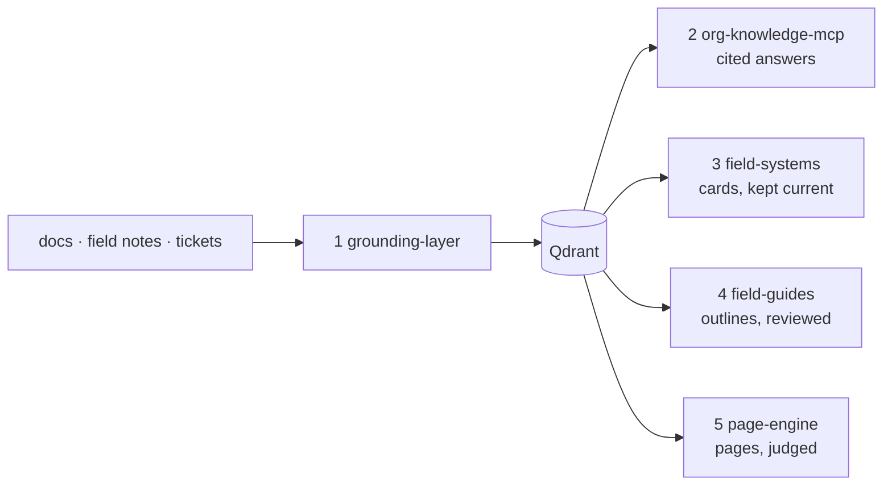

# field-kit

**Go-to-market systems you can run on a made-up company, each with a measured result in its README.**

A seller quotes a battlecard on a call. The docs changed that sentence three weeks ago, and the
customer is the one who points it out.

These kits take the sources a team already has (product docs, customer call notes, a support
queue) and turn them into the assets a field team uses. Every sentence in an asset traces
to a row in Qdrant, and a person approves each change.

Start here. Each kit lives in its own repo, and this table lists them in the order they run.

| Kit | You Get | Measured Result |
|---|---|---|
| 1. [grounding-layer](https://github.com/meinsta/grounding-layer) | A scheduled refresh that keeps docs, field notes and tickets current in Qdrant, ending in a recall gate | 9 of 10 golden questions find their answer in the top 3 |
| 2. [org-knowledge-mcp](https://github.com/meinsta/org-knowledge-mcp) | An MCP server that answers from those sources and checks each claim against the line it cites | 10 of 10 sourced claims accepted, 20 of 20 made-up claims rejected |
| 3. [field-systems](https://github.com/meinsta/field-systems) | Field cards, a weekly keep-current check and a review queue | A changed docs sentence was detected and proposed, then applied on approval |
| 4. [field-guides](https://github.com/meinsta/field-guides) | A guide outline with shipped facts and open questions kept apart, plus expert review | An expert comment moved its sentence to the open list |
| 5. [page-engine](https://github.com/meinsta/page-engine) | Product pages and paid landings where code judges the words you write | The shipped page built READY, and each of three bad leads was flagged |

I measured every result on a Qdrant Cloud cluster, using the fixtures each repo ships.

## Run the Whole Path From a Fresh Clone

Bring `python3`, `git` and a Qdrant Cloud cluster with Cloud Inference. The script uses the
standard library, so you can skip `pip install`.

```bash
git clone https://github.com/meinsta/field-kit && cd field-kit
export QDRANT_URL=... QDRANT_API_KEY=...
./start-here.sh
```

The script clones the kits into `kits/` and runs each in order against the same collection. On a
2-vCPU cloud host it finished in 37 seconds. Then open `kits/field-systems/cards`,
`kits/field-guides/out` and `kits/page-engine/out` to read the cards, the outline and the pages.

## Build Every Asset From the Same Collection



grounding-layer fills the collection. The other kits read it, so every fact in a card, an outline
or a page is a row you can look up.

## Learn on a Made-Up Company Called Quillfeather

Quillfeather Dispatch is a fictional delivery-routing API. Its fixtures give every kit the same
material: four docs pages, six field notes described by segment and vertical, three support
tickets, and ten golden questions with the sentences that answer them. When a kit works on
Quillfeather, swap in your own sources for that kit and move to the next.

## Trust the Rules Every Kit Keeps

Every kit sources its lines, judges them in code and waits for a person. A line in an asset carries
the id of the row it came from. Each gate is a function with tests, so the same input gets the
same verdict. A check proposes a change, and the change lands when someone accepts it.

## Build Your Own Kit on the Shared Code

This repo is also the library the kits import. Install it with
`pip install git+https://github.com/meinsta/field-kit`, or put the folder on `PYTHONPATH`.

```bash
python3 test_fieldkit.py        # runs offline
```

### Pass Evidence and Claims as Plain Dicts

The building blocks agree on these shapes, so any block can feed any other.

| Shape | Form |
|---|---|
| Evidence | `{id: text}` |
| Claim | `{"text", "source_id", "quote"?, "confidence"?}` |

A model writes claims, and code decides which ones ship.

### Pick the Building Blocks You Need

Each block is one file. This table lists each block's job and its requirements.

| Block | Job | Needs |
|---|---|---|
| [`qdrant`](fieldkit/qdrant.py) | Run hybrid search over REST: dense and BM25 fused with RRF, score boosts, grouping, recommendation and scroll. Qdrant Cloud Inference creates the embeddings. | Cluster |
| [`dag`](fieldkit/dag.py) | Run plain functions as a DAG that resumes from cached results, runs ready steps in parallel and reports where the time went. | Standard library |
| [`gate`](fieldkit/gate.py) | Accept a claim only when its `source_id` is in the evidence, repairing a mistyped id when the evidence proves it. `quote_gate` then requires the claim's quote verbatim in that source. | Standard library |
| [`memory`](fieldkit/memory.py) | Store judged outcomes in Qdrant and return the nearest failures, successes and lessons as a prompt block. | Cluster |
| [`recall`](fieldkit/recall.py) | Measure reach and per-question hit rate against a frozen golden set, starting with the ceiling: how many answers the index holds at all. | Standard library |
| [`preflight`](fieldkit/preflight.py) | Probe every dependency before a run. A blocking failure halts the run; the run reports an advisory one and continues. | Standard library |
| [`approvals`](fieldkit/approvals.py) | A person approves ids in a text file, and code binds only those. | Standard library |
| [`bridge`](fieldkit/bridge.py) | Queue the tool calls that need a signed-in connector. A headless session fulfills them, and the bridge caches each raw result by call. | Standard library |

### Start From a Recipe

A recipe composes blocks into something a customer can run.

| Recipe | Blocks | You Supply |
|---|---|---|
| [`grounded_answer`](recipes/grounded_answer.py) | qdrant, dag, gate, memory | Your LLM call that drafts claims |

## See What Each Kit Adds Next

Each kit covers the first part of its job today. This table lists each kit's next additions.

| Kit | Next |
|---|---|
| field-systems | Decks, a check that named proof customers are still customers, outreach drafts for account owners |
| field-guides | Drafting the guide from the outline, plus whitepaper and landing cuts |
| page-engine | A guide-landing track, HTML output, and a memory of past verdicts for a model that writes leads |

## Work With the Author

I'm [Meina Ghafouri](https://meina.me), a product marketer with an engineering background. These
kits are the open version of systems I built for a product marketing team. If you want them set up
on your own sources, you'll find the engagements at [meina.me](https://meina.me).
